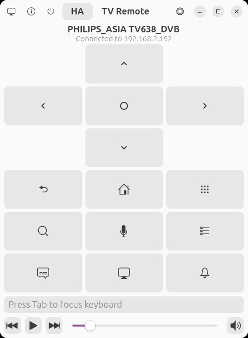
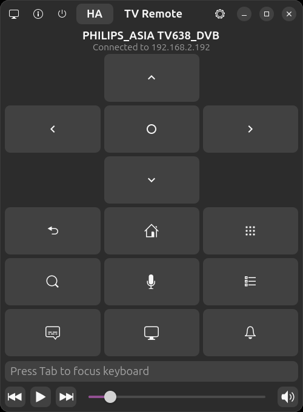

# TV Remote

A GTK-based remote control for Android TV and Google TV devices. It speaks the **Android TV Remote protocol v2**, the protocol used by the Google TV phone app, so there is no ADB or developer mode to set up: pair once with the code shown on the TV. Works with TVs that ship the Android TV Remote Service and with receiver apps such as TinyTV Receiver.

  

<br>

<div align="center">
  <a href="https://flathub.org/apps/io.github.erenseymen.android-tv-remote">
    
  </a>
</div>

| Light Mode | Dark Mode |
| :---: | :---: |
|  |  |

- **Smart Connectivity**: Automatically discovers and reconnects to devices even if their IP addresses change, using background network scanning and model verification.
- **Simple Pairing**: Pair once with the 6-character code the TV displays; the TV remembers this computer's certificate.
- **Live State**: Volume level and mute state are pushed by the TV, so the slider stays in sync.
- **Long Press Support**: Hold buttons (both in UI and keyboard) for secondary actions:
    - **Power**: Long-press for Power Menu (Restart/Sleep/Shutdown).
    - **OK/Select**: Long-press for Context Menus (options, add to favorites).
    - **Home/Back/Menu/Apps**: Long-press for various app-specific shortcuts.
- **Instant Seeking**: Hold any D-pad direction button (mouse or keyboard) for high-speed "Hold-to-Repeat" navigation.
- **Media Control**: Play/Pause, Previous/Next track buttons with a modern GTK4/Libadwaita design.
- **TV Input Routing**: Dedicated dialog for switching HDMI sources on a second TV (set its IP in Preferences), e.g. controlling TV inputs while connected to a streaming box.
- **Desktop Integration**: Full MPRIS support for controlling playback from GNOME media widgets, lock screen, and notifications.
- **Customizable Shortcuts**: All keyboard shortcuts are fully configurable in Preferences.

## Keyboard Shortcuts

*Essential shortcuts listed below. All are configurable in Preferences. Most shortcuts support **Long Press** for secondary actions.*

| Key | Action |
| --- | --- |
| Arrow Keys / **W A S D** | Navigate (Up/Down/Left/Right) — *Supports Hold-to-Repeat* |
| **Enter** / **E** | OK/Select — *Long Press for Context Menu* |
| **Esc** / **Q** / **Backspace** | Back |
| **H** | Home |
| **I** | Menu |
| **R** | Apps |
| **G** | Google Assistant |
| **Space** | Play/Pause |
| **Z** | Previous |
| **X** | Next |
| **M** | Mute |
| **+** or **.** | Volume Up |
| **-** or **,** | Volume Down |
| **Delete** | Power — *Long Press for Power Menu* |
| **C** | Captions/Subtitles |
| **T** | TV Input (Switch HDMI source) |
| **F** | Search (YouTube) |
| **Tab** | Focus Keyboard (Input text directly) |
| **N** | Notifications |
| **`** | Switch buttons between Direct and Home Assistant |


## Installation

```bash
flatpak install flathub io.github.erenseymen.android-tv-remote
flatpak run io.github.erenseymen.android-tv-remote
```

## Setup

1. Put the TV and the computer on the same network. The TV must run the Android TV Remote service (ports **6466** and **6467**): Google TV / Android TV devices have it built in; other TVs can use a receiver app such as TinyTV Receiver.
2. Open **Manage devices**, scan or type the TV's IP address, and click **Connect**.
3. Type the 6-character code that appears on the TV. That's it: later connections don't need a code.

### Home Assistant route (optional)

Some screens can't be steered by a receiver that injects keys through accessibility (TinyTV Receiver). For those, buttons can go through Home Assistant's **Android Debug Bridge** integration instead, which injects real key events over ADB:

1. Preferences → **Home Assistant**: enter the URL (e.g. `https://ha.example.com`), a long-lived access token (HA profile → Security) and the TV's remote entity (default `remote.living_room_philips_tv`). Press the ✓ on each row, then **Test**.
2. Switch with the **HA** button in the header or the **`** key (configurable). The subtitle shows which route is active, and the choice is remembered.

Both routes stay connected, so switching is instant and the volume keeps syncing from the TV. Buttons are sent as `remote.send_command` with `input keyevent <code>`. The token is stored in `~/.config/android-tv-remote/home-assistant/token` (owner-only), not in GSettings.

Notes on the protocol: it carries keys, text input, app links and volume/power state. Information that only ADB could read (the "Now Playing" title, whether a box has HDMI inputs) is not available.

## Tested Devices

- [Xiaomi TV Box S (2nd Gen)](https://www.epey.com/medya-oynatici/xiaomi-tv-box-s-2nd-gen.html)
- [Philips 50PUS7000](https://www.epey.com/televizyon/philips-50pus7000.html)

## Development

```bash
# Build and install locally
flatpak-builder --user --install --force-clean build-dir flatpak/io.github.erenseymen.android-tv-remote.yml

# Run locally
flatpak run io.github.erenseymen.android-tv-remote
```

## Project Structure

```
android-tv-remote/
├── src/gnome_adb_tv_remote/     # Main Application Package
│   ├── core/                  # Engine & Domain Logic
│   │   ├── remote_v2.py          # Android TV Remote protocol v2: pairing + remote control
│   │   ├── home_assistant.py     # Optional button route through Home Assistant (ADB integration)
│   │   ├── scanner.py            # High-concurrency network discovery engine
│   │   ├── mpris_service.py      # Linux Media Player (MPRIS) D-Bus integration
│   │   ├── keystore.py           # TLS client certificate generation and storage
│   │   └── network_info.py       # Local network interface & subnet detection
│   ├── ui/                    # Gtk4/Libadwaita Interface
│   │   ├── main_window.py        # Application coordinator & event handling
│   │   ├── remote_panel.py       # Remote controls & Now Playing dashboard
│   │   ├── device_dialog.py      # Device discovery & connection manager
│   │   ├── pairing_dialog.py     # Pairing code entry
│   │   ├── tv_remote_dialog.py   # HDMI/Input switching overlay
│   │   ├── preferences_dialog.py # Keyboard shortcut & routing settings
│   │   ├── info_dialog.py        # Help, about and instructions
│   │   └── ui_utils.py           # Reusable UI components & animations
│   ├── app.py                 # Adw.Application lifecycle management
│   └── __main__.py            # CLI entry point
├── data/                      # GSettings schemas, .desktop, Icons
├── flatpak/                   # Flatpak manifests & build configuration
├── pyproject.toml             # Dependency & build metadata
└── screenshots/               # UI presentation assets
```


## Technical Overview

The application utilizes **[PyGObject](https://gitlab.gnome.org/GNOME/pygobject)** (GTK4/Libadwaita) to deliver a modern, native Linux user interface. Communication with the TV uses the **Android TV Remote protocol v2** (the protocol of the Google TV phone app, documented by [androidtvremote2](https://github.com/tronikos/androidtvremote2)):

- **Pairing (port 6467)**: a TLS session using the "Polo" protocol. The TV shows a code; the app hashes it with both sides' RSA public keys and sends the result back, after which the TV trusts the app's client certificate.
- **Remote control (port 6466)**: a TLS session authenticated by that certificate, carrying key presses (short and long), text input, app links, pings, and volume/power updates from the TV.

Messages are varint length-prefixed protobufs encoded by a small hand-written encoder, and the self-signed client certificate is built with **[rsa](https://github.com/sybrenstuvel/python-rsa)**, so the app needs neither `protobuf` nor `cryptography`. Device discovery uses **[psutil](https://github.com/giampaolo/psutil)** to enumerate network interfaces and scans them for the remote port. Everything is pure Python and architecture-agnostic (`x86_64` and `aarch64`).

## License

Licensed under **GPL v3.0**. See [LICENSE](LICENSE).
Third-party licenses: [THIRD-PARTY-LICENSES.md](THIRD-PARTY-LICENSES.md).
